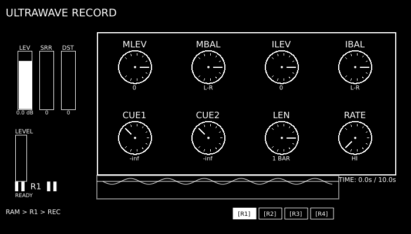
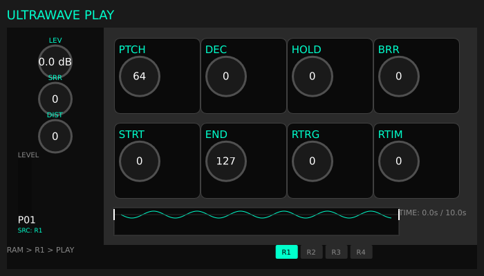

# Ultrawave

[](https://github.com/EphemeralDSP/ultrawave/actions/workflows/plugin-validation.yml)
[](https://github.com/EphemeralDSP/ultrawave/actions/workflows/build.yml)
[](https://github.com/EphemeralDSP/ultrawave/actions/workflows/release.yml)


Real-time RAM recording and playback plugins inspired by the Elektron Machinedrum UW RAM machines. Built with Rust and [NIH-plug](https://github.com/robbert-vdh/nih-plug).

## Overview

Ultrawave provides **two companion plugins** that share a global audio buffer:

| Plugin | Purpose | Audio I/O |
|--------|---------|-----------|
| **Ultrawave Record** | Captures audio to shared RAM buffer | Stereo In → (silent) |
| **Ultrawave Play** | Plays back from shared RAM buffer | MIDI In → Stereo Out |

Use them together in a DAW to sample and resample audio in real-time, similar to the Machinedrum UW's R1/R2 (record) and P1/P2 (play) machines.

### Workflow

1. Insert **Ultrawave Record** on a track to capture audio
2. Insert **Ultrawave Play** on an instrument track
3. Record captures audio to one of 4 shared buffers (R1-R4)
4. Play back via MIDI, with pitch, start/end points, filters, and bit-crushing

## Features

- 12-bit character (Machinedrum-style grit)
- 4 shared buffers (up to 10 seconds each)
- Real-time recording and playback across plugin instances
- Volatile RAM lifecycle: shared buffers are intentionally not persisted in
  plugin state/presets and are cleared after full plugin teardown/reload
- 24dB resonant filter (LP/BP/HP)
- Sample rate reduction (bit-crushing)
- MIDI-triggered playback with velocity sensitivity
- VST3 and CLAP formats

## Screenshots

### Ultrawave Record


### Ultrawave Play


## Building

```bash
# Install Rust
curl --proto '=https' --tlsv1.2 -sSf https://sh.rustup.rs | sh

# Clone and build
git clone https://github.com/EphemeralDSP/ultrawave.git
cd ultrawave
cargo build --release

# Bundle plugins (both Record and Play)
cargo xtask bundle ultrawave_record --release
cargo xtask bundle ultrawave_play --release
```

Built plugins are placed in `target/bundled/`:
- `ultrawave_record.clap` / `ultrawave_record.vst3`
- `ultrawave_play.clap` / `ultrawave_play.vst3`

## Plugin Formats

| Format | Windows | macOS | Linux |
|--------|---------|-------|-------|
| VST3   | ✓       | ✓     | ✓     |
| CLAP   | ✓       | ✓     | ✓     |
| AU     | -       | ✓     | -     |

## Development

See [CONTRIBUTING.md](CONTRIBUTING.md) for development guidelines.

### Validation

Ultrawave uses industry-standard plugin validators:

```bash
# Validate VST3
.\scripts\validate-vst3.ps1      # Windows
./scripts/validate-vst3.sh       # macOS/Linux

# Validate CLAP
.\scripts\validate-clap.ps1      # Windows
./scripts/validate-clap.sh       # macOS/Linux
```

See [docs/testing/plugin-validation.md](docs/testing/plugin-validation.md) for details.

## License

See [LICENSE](LICENSE) for details.
