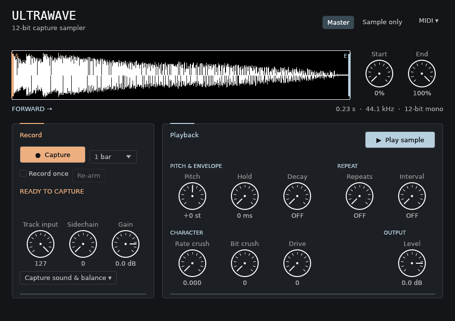

# Ultrawave

[Buildkite CI](https://buildkite.com/jmlynn/ultrawave)

A MIDI-controlled **audio effect** for real-time 12-bit RAM sampling, inspired by
the Elektron Machinedrum UW. **One instance captures and plays one mono sample.**
Built in Rust with [NICE-plug](https://codeberg.org/RustAudio/nice-plug)
and egui; available as VST3, CLAP, and a standalone application.

## Record and play in one instance

1. Insert **Ultrawave** on the audio track, group, send bus, or master you want to sample.
2. Play audio through that track. Leave **Track input** at 127 and **Sidechain** at 0.
3. Press **Capture**. The adjacent duration dropdown defaults to **1 bar**.
   When recording finishes, press **Play sample**. Both actions are always visible.
   MIDI note **48** captures; **50** plays. Change these in the small **MIDI**
   dropdown panel at the top right. Numbers are definitive because DAWs use
   different octave names. Automatable Capture/Playback rising edges also work.
4. **Master** mode (default) passes stereo input through and adds sample playback.
   Capture records this sum, including the sample's playback processing and level.
   Use **Sample only** for the previous input-only capture and sample-only output,
   for example on a dedicated send receiver.

There is no automatic access to the DAW master: insert on the master or route
that mix to the effect. **Track input** and **Sidechain** mix to mono before
capture gain and signed 12-bit quantization. In Master mode, Track input level
also scales the sampler's contribution to capture; it does not change audible
dry-through or playback. Sidechain feeds capture only, not dry output.
**Capture sound & balance** contains the source balances, capture rate,
rate crush (SRR) and drive. These print into the take during recording.
Playback has independent level, rate crush, bit crush (BRR) and drive controls.

**Master capture keeps the old take playable until recording finishes.** The
new take then replaces it and stops old playback/repeats; press Play sample or
send another Play Note to hear the replacement. Repeat this to resample previous
generations. Interrupted recordings keep their nonempty prefix; an empty attempt
retains the old take. Record once prevents replacement until re-armed.

**Sample only** replaces the old take and stops playback at capture start.
Playback triggered during that capture uses the written prefix at that instant.
The storage strategy is selected when capture starts; changing mode during a
take changes routing with a short ramp, but does not change that take's strategy.

### Renoise: use an FX alias, not a second plugin

1. Add **Ultrawave** to the source track's **Track DSP** chain.
2. In an empty instrument slot's **Plugin** tab, choose the **FX Alias** entry
   for that exact track's Ultrawave effect. The slot only sends notes to the
   existing effect; it does not create another sampler or another RAM bank.
3. Enter **C-4 (48)** to record and **D-4 (50)** to play using that alias
   instrument. Place the playback note after the capture duration. Notes may be on a separate
   pattern track; the sample audio comes out of the effect's track.
4. Enable **Record once** to keep the first take when the pattern loops. **Re-arm** allows
   another capture without clearing the current take.

For a mix of tracks, use a send/group receiver with Ultrawave. A normal `#Send`
feeds its **main input**. Renoise's `#Sidechain` device feeds its **sidechain**;
choose the receiver track and Ultrawave device, then raise Sidechain. Put a sidechain
receiver **after the sending tracks**: Renoise refuses sends to previous tracks.
Multiple sidechain senders sum. Select **Sample only** on a dedicated receiver
to avoid doubling the original source. For master resampling, put Ultrawave on
the **Master** track and leave **Master** mode selected; Capture/Playback automation
also works without an FX alias.

### Ableton Live and other hosts

Insert the VST3 effect on an audio/group track. On a MIDI track, choose that
audio track in **MIDI To**, then **Ultrawave** as the destination device. Send
48/50 notes or use host automation. Select a source in Live's plugin sidechain
panel when using Sidechain. This is standard MIDI-to-effect routing; Live execution
has not yet been verified here. Hosts without MIDI-to-effect routing can use
Capture and Playback automation instead. Live does not host CLAP natively.

## Character and playing controls

- Undithered, saturating signed **12-bit** capture: quiet tails lose precision,
  hot inputs clip. BRR reduces playback resolution further, down to 2 bits.
- SRR is sample-and-hold time reduction; it is independent of BRR. Distortion
  uses tanh drive. Pitch is varispeed with linear interpolation.
- **Cross Start and End for reverse playback.** Inverted interior markers reverse
  a slice; equal markers are silent. Direction/start latch on a trigger; end
  remains live within that direction. Pitch is set by Pitch, not the trigger note.
- Playback velocity controls loudness. NoteOff and zero-velocity notes do not
  choke a one-shot. Other note numbers are ignored. If both note assignments
  are equal, Record takes priority; use different notes for separate commands.
- Repeats 1–126 adds that many repeats; 127 is **INF**. Repeats 0 or Interval 0 cancels
  repeats without cutting the current hit. A new note replaces the old train.
  Host stop/reset stops recording and playback, preserving RAM.
- Interval follows host tempo (120 BPM fallback). Values 127/109/96/77/64/44/32 are
  1/16, 1/16T, 1/32, 1/32T, 1/64, 1/64T, 1/128. Fractional intervals retain their
  remainder; tempo changes preserve interval progress. Reported landmarks come
  from [Tarekith's tips](https://tarekith.com/assets/machinedrum_tipsandtricks.htm#Reference),
  not a measured firmware timing law.

### Record once and project saving

Record once records on the first trigger for the chosen duration (or capacity),
then shows **SAMPLE PROTECTED** and ignores further capture triggers. Re-arm,
or a rising Re-arm automation edge,
allows another take. Re-arming waits for the next trigger and is ignored during
capture. Disabling Record once restores repeated recording; enabling it during a
take protects that take. Transport stop/start does not re-arm.

**Projects save controls, not audio or the Record once runtime latch.** A newly
loaded instance starts with empty RAM and an armed recorder. An existing
instance keeps RAM across transport resets. Restoring or resetting a held-high
Capture, Playback or Re-arm control does not count as a new trigger: automate
Off → On for a new command. MIDI triggers and editor buttons remain available.
Every instance owns separate RAM:
no banks, pairing, shared-memory files, cross-project leaks, or recovery workers.
This replaces the old Record/Play pair; old plugin IDs/presets are not supported.

## Editor

One 920×650 pane shows Record and Playback together. The waveform has draggable
Start/End handles and adjacent Start/End knobs linked to the same controls,
dimmed excluded audio and a reverse indicator. Master/Sample only sits in the header.
MIDI assignments are dropdowns in a small panel, not sound knobs. Click numeric
values to type; drag knobs vertically, Shift-drag for fine changes, double-click
to restore defaults.



## Build and install

Requires Rust 1.95+ and SSH access to the pinned `EphemeralDSP/ephemeral` DSP
dependency. Linux development packages are listed in `ci/scripts/deps-linux.sh`.
NICE-plug/core 0.4.2 and egui adapter 0.5.1 are pinned. The framework is ISC;
VST3 bindings are MIT/Apache-2.0. See [vendor patches](vendor/README.md).

```bash
cargo build --release
cargo xtask bundle ultrawave-plugin --release
# Produces target/bundled/ultrawave-plugin.{vst3,clap}
cargo xtask install
```

Install destinations: `~/.vst3` / `~/.clap` on Linux, and
`~/Library/Audio/Plug-Ins/{VST3,CLAP}` on macOS. Close hosts before replacing a
loaded binary, then rescan. The new bundle does not overwrite the old pair.

## Fast offline iteration

```bash
./scripts/dev-loop.sh fast          # Tests, exported CLAP audio/state, VST3 state, WAVs
./scripts/dev-loop.sh fast --watch  # Repeat after source changes
./scripts/dev-loop.sh full --editor # Clippy, release tests, validators, benchmark, UI lifecycle
./scripts/screenshot.sh            # Empty/loaded sample; inspect screenshots/*.png
./scripts/audition.sh              # Six deterministic WAVs + audio metrics, no DAW/device
```

The CLAP harness loads the actual cdylib and checks routing, timing, MIDI note
assignment, Record once, replacement, reverse/retrigger, saved controls, private RAM and instance
recreation at 44.1/48/96 kHz. These are software regressions, not hardware A/Bs.
Failures stop the pass. Validators belong on PATH or in `target/tools/`.

Individual offline renders use the same DSP and explicit private RAM:

```bash
target/release/ultrawave record --input tests/vinyl909.wav --output target/capture.wav
target/release/ultrawave play --input target/capture.wav --output target/crunch.wav \
  --pitch 52 --brr 32 --srr 0.5 --dist 16
target/release/ultrawave play --input target/capture.wav --output target/reverse.wav \
  --start 127 --end 0
target/release/ultrawave play --input target/capture.wav --output target/retrig.wav \
  --retrigger 127 --retrig-time 127 --tempo 120 --output-secs 4
```

WAV tools require 44.1 kHz input. Integer synthesis controls range 0–127; pitch
64 is unity, 52/76 one octave down/up. SRR ranges 0–0.9629. `--output-secs` bounds
even infinite retrigger renders. Start listening quietly: drive raises loudness.
For live standalone audio/MIDI device options use `target/release/ultrawave --help`.
On Linux JACK/PipeWire connect source audio and MIDI through your patchbay.

### Actual Renoise regression

```bash
cargo xtask bundle ultrawave-plugin --release
./scripts/renoise-test.sh
```

Requires Renoise 3.5.4, Xvfb, xdotool, ImageMagick and Python. Uses a disposable
HOME/display and only the newly built bundle, leaving personal sessions and
installed plugins untouched. Tests FX-alias notes, main/sidechain routing,
actual Master-track resampling, sample-only output, Record once, replacement,
reverse/retrigger, project save and process
reopen. Artifacts and logs: `target/renoise-test/`. This exercises VST3; the CLAP
harness and clap-validator exercise CLAP. `tests/test.RPP` remains unverified
historical scratch, not a supported setup.

## Fidelity and platform limits

**UW-inspired, not bit-exact Machinedrum emulation.** Quantization, interpolation,
envelopes, drive and intermediate retrigger curves still need hardware captures.
No measured DAC equalization or fixed hardware sample-clock model is claimed.
RAM stores its source rate; 44.1/48/96 kHz playback preserves duration and pitch.
Each instance has capacity for 441,000 samples: 10 s at 44.1 kHz, 9.19 s at 48 kHz,
4.59 s at 96 kHz with Capture rate HI. Reduced rate also observes the ten-second
capture-time cap. Timed capture lengths are 1/2, 1, 2, 4, 8, 16 or 32 quarter-note
beats; the last four appear as 1/2/4/8 bars. Maximum fills available capacity.

Capture mixing uses SSE2 on x86-64 and NEON on supported AArch64 targets with
scalar tails/fallback. Stateful SRR/envelopes remain sequential. Allocation
checks and scalar equivalence tests protect the real-time path; run
`cargo run --release --example dsp_bench` for local measurements. Linux x86-64
is the exercised platform. macOS/ARM, Live, and hardware A/B remain to be verified.

See [CONTRIBUTING.md](CONTRIBUTING.md) and [LICENSE](LICENSE).
